  <picture>
    <source media="(prefers-color-scheme: dark)" srcset="assets/header-dark.svg" />
    <source media="(prefers-color-scheme: light)" srcset="assets/header-light.svg" />
    
  </picture>

Full-stack software engineer building fast, reliable, local-first software — from native desktop utilities and offline Android apps to systems tooling and web applications. I care about clean architecture, lean dependencies, and software that stays out of your way.

---

### Focus Areas

<table width="100%">
  <tr>
    <td width="50%" valign="top">
      <strong>Systems &amp; Desktop</strong> 
      Native tooling, media pipelines, and cross-platform GUI/CLI utilities built with <strong>Rust</strong>, <strong>egui</strong>, and <strong>FFmpeg</strong>.
    </td>
    <td width="50%" valign="top">
      <strong>Mobile (Android)</strong> 
      Offline-first Android apps designed around speed, privacy, and zero cloud lock-in using <strong>Kotlin</strong> and <strong>Jetpack Compose</strong>.
    </td>
  </tr>
  <tr>
    <td width="50%" valign="top">
      <strong>Full-Stack &amp; Web</strong> 
      End-to-end applications, backend tooling, and automation built with <strong>Python</strong> and modern web technologies.
    </td>
    <td width="50%" valign="top">
      <strong>Modding, Graphics &amp; Games</strong> 
      JVM/Fabric ecosystem engineering, shaders, and cross-platform 2D games using <strong>Java</strong>, <strong>GLSL</strong>, and <strong>Godot</strong>.
    </td>
  </tr>
</table>

---

### Selected Public Projects

| Project | Description | Stack |
| :--- | :--- | :--- |
| **[resolvify](https://github.com/txjc06/resolvify)** | One-click desktop transcoder turning any video into a DaVinci Resolve–ready `.mov` with working picture, 24-bit PCM audio, and locked frame rate. | `Rust` `egui` `FFmpeg` |
| **[Ascendance](https://github.com/txjc06/Ascendance)** | Cross-platform 2D platformer built with Godot 4.3, with prebuilt releases for Linux, Windows, and Android. | `GDScript` `GDShader` `Godot` |
| **[dripleaf-finder](https://github.com/txjc06/dripleaf-finder)** | Minecraft Fabric addon that locates spliced small dripleaf in-game and predicts generation coordinates directly from world seeds. | `Java` `Python` `GLSL` |

*Most active work currently lives in private repositories — public releases land here as they mature.*

---

### Tech Stack

**Languages**

  
  
  
  
  
  
  
  
  

**Platforms & Tools**

  
  
  
  
  
  
  
  

---

### GitHub Overview

  <picture>
    <source media="(prefers-color-scheme: dark)" srcset="https://github-readme-stats.vercel.app/api?username=txjc06&show_icons=true&hide_rank=true&hide=issues&card_width=370&title_color=38bdf8&icon_color=818cf8&text_color=c9d1d9&bg_color=0d1117&border_color=30363d&border_radius=10" />
    <source media="(prefers-color-scheme: light)" srcset="https://github-readme-stats.vercel.app/api?username=txjc06&show_icons=true&hide_rank=true&hide=issues&card_width=370&title_color=0284c7&icon_color=4f46e5&text_color=1f2328&bg_color=ffffff&border_color=d0d7de&border_radius=10" />
    
  </picture>
  &nbsp;
  <picture>
    <source media="(prefers-color-scheme: dark)" srcset="https://github-readme-stats.vercel.app/api/top-langs/?username=txjc06&layout=compact&langs_count=5&size_weight=0.5&count_weight=0.5&card_width=370&title_color=38bdf8&text_color=c9d1d9&bg_color=0d1117&border_color=30363d&border_radius=10" />
    <source media="(prefers-color-scheme: light)" srcset="https://github-readme-stats.vercel.app/api/top-langs/?username=txjc06&layout=compact&langs_count=5&size_weight=0.5&count_weight=0.5&card_width=370&title_color=0284c7&text_color=1f2328&bg_color=ffffff&border_color=d0d7de&border_radius=10" />
    
  </picture>

